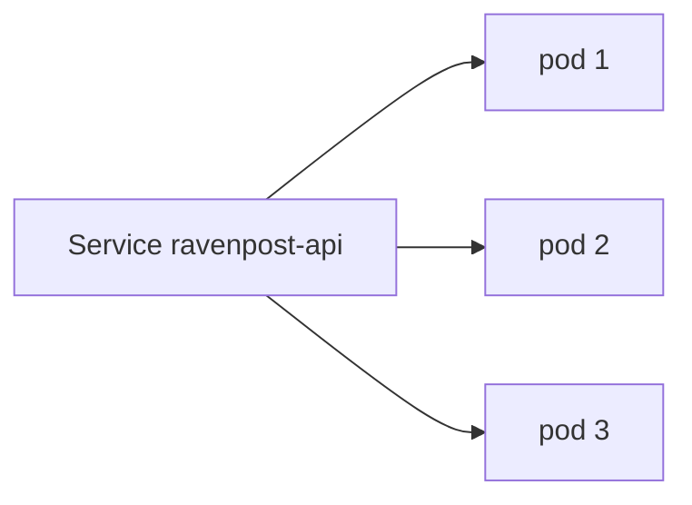

{/* Every lesson component, for #/kitchen-sink and the E5-02 checks. Files starting with _ aren't course content. */}

<Step id="sample" title="A sample step">

<Analogy
  then="You restarted a service with systemctl when it fell over."
  now="The kubelet restarts the container for you, and counts each restart."
/>

<Callout kind="habit">Check which context you're in before you change anything.</Callout>

<Diagram alt="A Service sends requests to the three pods that match its selector">

</Diagram>

<Depth>
  <ELI5>A pod is a box the cluster puts your program in, so it can start, stop and move it.</ELI5>
  <Operator>
    A pod is the unit the scheduler places: one or more containers sharing an IP and volumes,
    restarted by the kubelet.
  </Operator>
  <DeepDive>
    The kubelet runs a pod sandbox (pause container) holding the network namespace; app containers
    join it through the CRI.
  </DeepDive>
</Depth>

Press <Kbd>Tab</Kbd> to complete a name.

<CodeBlock language="console" caption="See the pods" code="kubectl get pods -n ravenpost -o wide" />

</Step>

<Step id="checks" title="Knowledge checks">

<Check id="sample-single" />

<Check id="sample-multiple" />

<Check id="sample-ordering" />

<Check id="sample-matching" />

<Check id="sample-bug" />

</Step>
