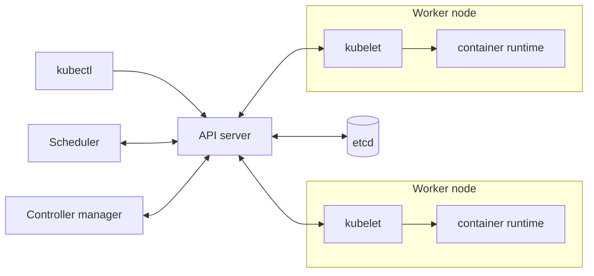

<Step id="castle" title="A castle that keeps to its plan">

<Depth>
  <ELI5>
    Picture a castle with a plan pinned to the wall. Stewards walk the halls all day. When something
    doesn't match the plan, they fix it. Nobody has to tell them twice.
  </ELI5>
  <Operator>
    A cluster is a set of <Term id="node">nodes</Term> run by a **control plane**: a few programs
    that store the desired state, decide where work goes, and keep correcting the cluster toward the
    plan. You talk only to the control plane; it talks to the nodes.
  </Operator>
</Depth>

<Diagram alt="Cluster anatomy. kubectl talks to the API server. The API server stores state in etcd. The scheduler and the controller manager watch the API server. On each worker node, a kubelet watches the API server and starts containers through the container runtime.">

</Diagram>

</Step>

<Step id="control-plane" title="The control plane">

- **The API server** is the front door. Every request, from `kubectl` or from inside the cluster, goes
  through it, and it checks who you are and whether the request is valid.
- **etcd** is the memory: a small, careful database that holds the desired and current state.
- **The scheduler** chooses a node for each new pod, from what the pod asks for and what each node has
  free.
- **The controller manager** runs the <Term id="controller">controllers</Term>, each comparing one kind of
  object with the plan and fixing the difference.

<Analogy
  then="A change went through the change board, was written in the change log, and someone was assigned to do it."
  now="A request goes through the API server, is written to etcd, and a controller or the scheduler acts on it."
/>

</Step>

<Step id="nodes" title="Nodes and the kubelet">

Each node runs a **kubelet**: an agent that watches the API server for pods assigned to its node, starts
their containers through the container runtime, and reports back how they're doing. If a container exits,
the kubelet restarts it.

In Ravenpost's cluster, the control plane runs on one node and the work runs on two others. See for
yourself:

<CodeBlock
  language="console"
  caption="The nodes, and the control plane's own pods"
  code={`kubectl get nodes
kubectl get pods -n kube-system -o wide`}
/>

</Step>

<Step id="trace" title="From a request to running pods">

When a Deployment asks for three pods:

1. The API server records the Deployment in etcd.
2. A controller sees it, and creates three pod objects (with no node yet).
3. The scheduler gives each pod a node.
4. Each node's kubelet sees its new pod and starts the containers.
5. The kubelets report back, and the pods show Running.

None of these steps waits for you. That's the castle restoring itself to the plan.

</Step>

<Step id="check" title="Check your understanding">

<Check id="anatomy-scheduler" />

<Check id="anatomy-order" />

<Check id="anatomy-kubelet" />

</Step>
