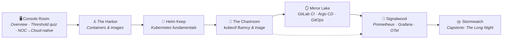
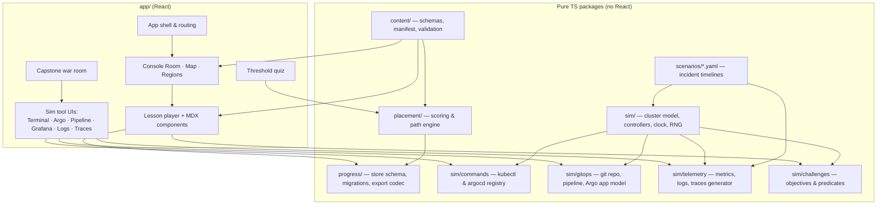
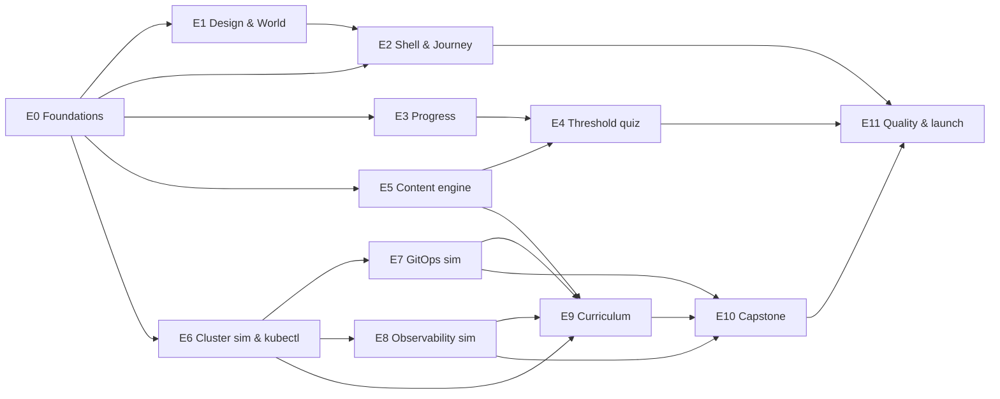
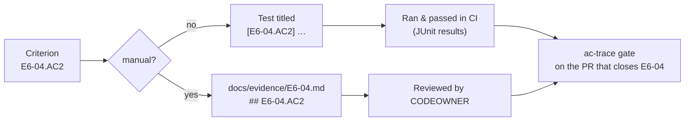

# Beyond the Glass — Roadmap

> *For years you watched the glass. Now step through it.*

An interactive, self-paced web app that takes operators who came up through on-prem, eyes-on-glass operations roles and gets them **effectively troubleshooting a failing microservice** using `kubectl`, Argo CD, Grafana/Prometheus and OpenTelemetry. It's hosted entirely on GitHub Pages. Every hands-on exercise runs against an **in-browser simulation**, so learners don't need a cluster, an install or credentials.

---

## 1. Goals and non-goals

### Goals
1. **Meet people where they are.** A short placement quiz (the *Threshold*) sets a personal path from an ELI5 starting point up to production troubleshooting.
2. **Bridge, don't replace.** Explicitly map what learners already know (servers, init scripts, change tickets, Nagios checks, `tail -f`) to the cloud-native equivalent.
3. **Practice safely.** Simulated `kubectl`, `argocd`, GitLab pipelines, Argo CD UI, Grafana dashboards, logs and traces, all driven from a single, consistent incident timeline.
4. **Teach the right habits.** Check your context, gather evidence before acting, fix through Git (not `kubectl edit` in prod), and correlate metrics → traces → logs.
5. **Be welcoming and accessible.** Target WCAG 2.2 AA, keyboard-first, screen-reader-tested, reduced-motion aware, and non-judgmental in tone.
6. **Be engaging.** A story with real wonder: the learner steps through a CRT monitor in a dim 1990s ops room and arrives in a living world.

### Non-goals (v1)
- No backend, accounts, telemetry/analytics, or server-side progress aggregation.
- No real cluster access from the app (an optional local kind lab may come later; see §10).
- No full PromQL or full `kubectl` implementation. We build a **curated, realistic subset** and give clear "not supported in this sim" messages.
- Not a certification-prep course (CKA/CKAD).

---

## 2. Audience

| Persona | Background | Starting point | Needs |
|---|---|---|---|
| **The Watchstander** | 15–25 yrs ops, NOC/console monitoring, ticket-driven, Windows/Unix on-prem | ELI5 | Mental-model bridge, confidence, low-stakes practice, plain language |
| **The Sysadmin** | Strong Linux/networking, scripting, VMs; little or no containers | Containers → K8s | Fast path through the basics, analogies to systemd/VMs/load balancers |
| **The Container-curious** | Has used Docker, some `kubectl get pods`; no GitOps/o11y | K8s ops → GitOps | Troubleshooting patterns, GitOps discipline, telemetry correlation |
| **The Practitioner** | Comfortable with `kubectl`; weak on traces/PromQL/Argo | GitOps → Signals → Capstone | Test out of basics, deep practice on observability and the capstone |

**Design implications:** Some learners will find an "aptitude test" threatening. The quiz is framed as *choosing your starting trail*, always includes an "I'm not sure yet" option, never shows a numeric score, and the learner can always override where they start.

---

## 3. Experience design: the world

> **IP guardrail:** The *feeling* we want is "children stepping from a spare room into an enchanted forest." The world, characters, names and imagery are **entirely original**. We use no Narnia (or other copyrighted) names, characters, creatures or iconic props such as a lamp-post, a lion, a wardrobe or a witch. CI enforces a denylist (see E0-06).

### The frame
The learner starts in **the Console Room**: a dim operations room around 1998. It has a CRT glow, beige towers, a pager on the desk, a wall of status lights and a coffee ring on a printout. This is home base and the journey overview. After the Threshold quiz, one monitor begins to ripple. The learner reaches toward it and **steps through the glass** into **the Reach**, a bright, living landscape where every system they knew has an analogue.

### Regions (curriculum map)

| Region | Metaphor | Content |
|---|---|---|
| **Console Room** | Where you came from | Journey overview, Threshold quiz, *From the NOC to the Cluster* mindset module, Field Guide (glossary + "Rosetta Stone") |
| **The Harbor** | Shipping containers, manifests, warehouses (registries) | What a container is, images vs containers, tags, registries, immutability |
| **Helm Keep** | *Kubernetes* is Greek for "helmsman"; the keep's stewards constantly restore order | Cluster anatomy, pods, deployments/replicasets, reconciliation, services/DNS, config/secrets, probes, requests/limits |
| **The Chartroom** | Navigators reading charts and instruments | `kubectl` contexts, get/describe/logs/events, output formats, selectors, the triage flow, common failure states |
| **Mirror Lake** | The lake's reflection is *desired state*; the shore is *live state*; ripples are *drift* | Commit → GitLab pipeline → image → manifest → Argo CD sync; health/sync, diff, drift, rollback via Git |
| **Signalwood** | A forest that speaks in signals: metrics, logs and traces | RED/USE, Grafana dashboards, PromQL basics, OTel spans and context propagation, the Collector, log/trace correlation, alerts and SLOs |
| **Stormwatch** | A storm night at the watchtower | **Capstone, "The Long Night":** the fictional *Ravenpost* service fails in several layered ways |

### Ranks (placement output, shown as a trail rather than a grade)
Wayfarer → Deckhand → Navigator → Pathfinder. A rank applies **per domain**, not globally.

### Depth layers
Each core concept has three tabs: **ELI5** (analogy, no jargon), **Operator** (what you type and what you'll see) and **Deep dive** (how it actually works). Placement sets the default tab, and the learner can always switch.

### Tone
The voice is warm, plain and respectful of experience. Never "simply" or "just". Every new term links to the Field Guide. ELI5 sections target a grade 6–8 reading level.

---

## 4. Architecture

### Stack (decided)
- **React + Vite + TypeScript (strict)**; **React Router with HashRouter**, so deep links work on GitHub Pages without a 404.html hack
- **Zustand** with persist middleware for state; **Zod** for all schemas (progress, content, scenarios)
- **Tailwind CSS** with CSS-variable design tokens; **Radix UI** primitives for accessible widgets
- **MDX** for lessons; YAML/JSON for quiz banks and scenarios, validated at build time
- **Motion** (Framer Motion) for transitions, respecting `prefers-reduced-motion`
- **Custom accessible terminal component.** It is not xterm.js, whose canvas rendering is weak for screen readers.
- Observability views mirror **Grafana Explore with Prometheus, Tempo and Loki**, matching the team's stack: exemplars → Tempo traces, trace → Loki logs, Loki derived fields → Tempo
- Charts: an SVG-based library (choose in ADR between visx and Recharts), always with a data-table alternative
- **Vitest + Testing Library**, **Playwright + axe-core**, **Lighthouse CI**
- **GitHub Actions → GitHub Pages** (primary). The same bundle (relative `base: './'` + HashRouter) also ships as a **container image** (`nginx-unprivileged`, non-root, ≤ 30 MB) for local, internal-cluster or air-gapped hosting
- **Zero runtime third-party network requests.** Fonts and assets are self-hosted, so the app works on restricted networks.

### Module layout

### Key design principles
1. **One timeline, many views.** Each scenario defines a single incident timeline: deploys, config changes, faults, load. The cluster state, events, Argo status, metrics, logs and traces are *all derived from it*. A pod restart at T+4m therefore appears in `kubectl get events`, in the restart-count panel, in the logs and as a gap in the traces. Consistency across views is the most important property of the simulator.
2. **Deterministic.** Seeded RNG and a simulated clock make every scenario reproducible and testable with golden files.
3. **Simulator core is framework-free.** `sim/` is pure TypeScript with exhaustive unit tests, and the UI is a thin layer over it.
4. **Registry pattern everywhere.** Commands, lesson components, check types and panels each register in their own file, so parallel agents rarely edit the same file.
5. **Realism anchored to reality.** `kubectl`/`argocd` output formats are checked against fixtures captured from a real kind cluster (E6-11).
6. **Fail kindly.** Unsupported commands explain what *would* happen and suggest a supported alternative.

### Persistence
- The store is in `localStorage`, under one versioned key, with schema migrations.
- **Export/import progress code:** JSON → deflate (`CompressionStream`) → base64url, with a checksum. It's also downloadable as a `.json` file.
- **Lead view:** a lead can paste a learner's progress code to see a read-only summary. No backend required.
- No PII is stored. A display name is optional.

---

## 5. Milestones

| # | Milestone | Outcome | Exit criteria |
|---|---|---|---|
| **M0** | Foundations | Repo, CI, Pages deploy, guardrails, design direction | Green CI on `main`; site deploys; DoD enforced by checks |
| **M1** | Walking Skeleton | A real learner can open the site, see the overview, take the quiz, get a path, do **one** lesson with **one** terminal challenge, close the tab and resume | End-to-end Playwright test of that journey passes against the deployed site |
| **M2** | Core Engines | Simulator, content engine, design system and terminal are feature-complete enough for authors | An author can write a new lesson with a sim challenge in MDX + YAML alone, without touching engine code |
| **M3** | Foundations Trails | Console Room, Harbor, Helm Keep and Chartroom content | Watchstander persona can go from ELI5 to completing Chartroom triage scenarios |
| **M4** | GitOps & Signals | Mirror Lake and Signalwood sims and content | Learner can trace a deploy from commit to Argo sync and diagnose a latency issue from dashboard → trace → logs |
| **M5** | Capstone | *The Long Night* playable end to end with debrief | Pilot learners complete it; expert solution path verified by test |
| **M6** | Pilot & Launch | Audited, performant, documented, piloted | All launch success criteria in §6 met |

**Parallelism.** After M0, E1/E3/E5/E6 can run concurrently. E7 and E8 can run concurrently once E6-01 and E6-04 land. Content issues in E9 parallelize freely once E5-02 and E6-10 exist.

---

## 6. Success criteria (product level)

### Launch gates (must all be true for v1)
- [ ] A first-time visitor reaches the Threshold quiz in **≤ 2 clicks** from the landing view.
- [ ] Quiz has 12 questions by default (configurable 5–15) and median completion in pilot is **≤ 8 minutes**.
- [ ] Every learner journey (all 4 personas) is covered by a Playwright test, from landing to capstone debrief, using the sim's expert-path script.
- [ ] Progress survives reload, browser restart and export → import into a different browser **with zero loss** (property-based test).
- [ ] **0** axe-core violations on every route; manual audit with NVDA + Firefox, JAWS + Chrome/Edge and VoiceOver + Safari passes WCAG 2.2 AA.
- [ ] All interactions are keyboard-operable; focus is always visible; content reflows at 400% zoom.
- [ ] Lighthouse (desktop) on deployed site: Performance ≥ 90, Accessibility = 100, Best Practices ≥ 95.
- [ ] Initial JS ≤ 250 KB gzipped. Sim tool UIs are code-split.
- [ ] **0** runtime requests to third-party origins (verified in Playwright with network interception).
- [ ] Content-safety and IP denylist checks pass. No internal hostnames, IPs, system names or CUI anywhere in the repo.
- [ ] Capstone exercises at least **6 distinct failure modes** across Kubernetes, GitOps and observability layers.
- [ ] The container image passes its smoke suite, security scan and size budget (E0-09).
- [ ] **100% of acceptance criteria are traced** (`python3 scripts/ac-trace.py --strict-all` passes): every automated criterion by a passing tagged test, every manual one by a reviewed evidence entry.

### Outcome measures (pilot with 5+ team members)
- ≥ 80% of pilot learners complete the Threshold quiz and at least one full region.
- ≥ 60% complete the capstone within two weeks of starting.
- Self-reported confidence in troubleshooting a failing service (1–5) rises by **≥ 1.5 points** from before to after.
- In a tabletop exercise after the pilot, learners use the triage flow (context → get → describe → events → logs → metrics → traces) without prompting.
- System Usability Scale (SUS) score ≥ 75.

---

## 7. Risks and mitigations

| Risk | Impact | Mitigation |
|---|---|---|
| Simulation feels fake or diverges from real tools | Learners lose trust; habits don't transfer | Golden fixtures from a real kind cluster (E6-11); SME review gates on content; "one timeline" principle |
| Scope creep in sim fidelity (full PromQL, every kubectl verb) | Never ships | Curated subset with documented support matrix; "not supported in sim" responses; ADRs |
| Quiz feels like an evaluation; learners disengage or game it | Wrong placement, low adoption | Non-judgmental framing, no scores shown, "I'm not sure" option, override always available, results stay local |
| GitHub Pages unavailable or later blocked | Nobody can use it | Reachability confirmed. Fallback container image (E0-09) runs on a laptop, an internal cluster or air-gapped |
| Public repo leaks internal details | Security/OPSEC incident | Generic fictional service (Ravenpost), CI denylist sourced from a repo secret, PR review checklist |
| IP infringement from "Narnia-like" prompt to agents | Takedown, embarrassment | Original world spec (§3), CI denylist of franchise terms, art direction doc |
| Agent-produced illustrations look inconsistent | Weak "wonder" factor | Art direction doc + tokens first; SVG layered scenes; option to swap in commissioned art later without code changes |
| Accessibility of rich sim UIs (trees, charts, terminals) | Excludes learners; non-compliance | Every visual tool has a text/table equivalent; a11y criteria in every UI issue; manual AT audit |

---

## 8. Open questions (decide before or during M0)

1. **Repo visibility.** Public repo + public Pages site (assumed), or a private repo with Pages access control (requires GitHub Enterprise Cloud)?
2. ~~Network reachability~~ **Resolved:** `*.github.io` is reachable; a container image is the fallback (E0-09).
3. ~~Tracing backend~~ **Resolved:** Tempo + Loki in Grafana.
4. **Real cluster lab.** Do we want an optional local kind/k3d companion lab after v1? (Captured as a stretch idea, not planned.)
5. **SME reviewers.** Who besides Ben reviews content accuracy for each region?

---

## 9. How acceptance criteria are verified

Every criterion in the plan has a stable tag: `E6-04.AC2` for issue acceptance criteria and `E6.SC1` for epic success criteria. Criteria marked `manual` need human judgment (sign-off, screen-reader notes, pilot data).

See [`docs/testing/acceptance-criteria.md`](../testing/acceptance-criteria.md).

## 10. How to work this plan

- Epics live in [`docs/plan/epics/`](epics/), one file per epic, and each issue has an ID like `E6-04`.
- `scripts/create-issues.py` turns those files into GitHub labels, milestones, epic issues and child issues with dependencies linked. It's dry-run by default.
- Coding agents start from [`AGENTS.md`](../../AGENTS.md), which holds the conventions, Definition of Done and guardrails.
- Pick issues labeled `agent-ready` whose dependencies are closed. An issue is "done" only when every acceptance-criteria box is checked in the PR description.

## 11. Stretch ideas (not scheduled)
- Optional local kind lab that reproduces the capstone with real manifests (the E0-09 k8s manifests are a natural starting point)
- Offline/PWA mode for air-gapped review
- Spaced-repetition "field drills" (daily 3-minute triage puzzles)
- Additional capstones (e.g., certificate expiry, node pressure, DNS failure)
- Facilitator mode for running group tabletop exercises off the sim
