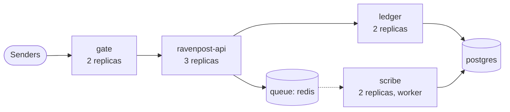
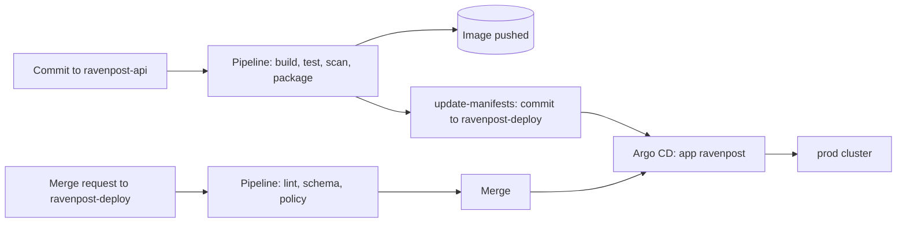

# Ravenpost: the on-call handbook

Ravenpost carries messages between the regions of the Reach, the way ravens once did. This is the
handbook for the people who keep it running: what's where, what normal looks like, and where to look
first. The simulation's reference system (`src/scenarios/stormwatch.yaml`, E10-01) is exactly this
service, healthy. "The Long Night" (E10-02) starts from it.

Everything here is fictional: no real hosts, systems or people.

## The service

| Service | What it does | Normal |
|---|---|---|
| `gate` | Takes messages in from senders (`POST /messages`) | ~60 requests a second, more in the afternoon; p99 under 200 ms |
| `ravenpost-api` | Records each message in the ledger and queues it for delivery | Same rate as the gate |
| `ledger` | The record of every message, in postgres | A few milliseconds per write |
| `postgres` | The database behind the ledger | One replica; its memory sits around 600 MiB of 1 GiB |
| `queue` | Redis: deliveries waiting for the scribe | Nearly empty |
| `scribe` | The worker that delivers messages and marks them done | ~8 deliveries a second |

Configuration lives in the `ravenpost-api-config` and `ledger-config` ConfigMaps.
`FEATURE_BATCH_LOOKUP` is off in production and on in staging.

## Clusters and contexts

| Context | Cluster | Namespace | Runs |
|---|---|---|---|
| `prod` | prod.ravenpost.example | `ravenpost` | Everything above |
| `stage` | stage.ravenpost.example | `ravenpost-stage` | gate, ravenpost-api, ledger (one replica each) |

Check `kubectl config current-context` before you change anything.

## Signals: where to look

- **Dashboards:**
  - **Service Overview (RED):** rate, errors and p99 per service. Deploys show as dotted lines.
  - **Kubernetes Workloads:** replicas, restarts, memory against limits, and recent error logs.
  - **Ravenpost SLO:** gate availability against 99.9%, and latency against 95% within 500 ms.
- **Metrics:** `http_server_requests_total`, `http_server_request_duration_seconds_*`,
  `kube_pod_container_status_restarts_total`, `container_memory_working_set_bytes`,
  `kube_deployment_status_replicas_available`.
- **Logs:** JSON lines. Request lines carry `trace_id` and `span_id`. Try `{namespace="ravenpost"} | json | level="error"`.
- **Traces:** one sampled request per entry service every 15 seconds, through every service it calls. Try
  `{ status = error }` or `{ resource.service.name = "ledger" && duration > 200ms }`.

## How a change ships

- **`ravenpost-deploy`** holds what runs where: `prod/` for the prod cluster, `stage/` for staging.
- **Merge requests** to it must pass `yaml-lint`, `schema` and `policy-check`: no `:latest` tags, and
  every container has a memory limit.
- **Argo CD** application `ravenpost` syncs `prod/` automatically, with **self-heal**: a change made with
  kubectl is put back within three minutes. Change Git instead. `ravenpost-stage` syncs automatically,
  without self-heal.

## Alerts and runbooks (stubs)

| Alert | Severity | First steps |
|---|---|---|
| `RavenpostHighErrorRate` | page | Error ratio per service: which one fails first? Then traces with `{ status = error }` |
| `KubeDeploymentReplicasUnavailable` | page | `kubectl get pods -n ravenpost`, then `describe` the failing pod |
| `RavenpostHighLatency` | ticket | p99 per service: latency travels up the call chain. Open a slow trace |
| `KubePodCrashLooping` | ticket | `kubectl describe pod` (Last State), then `kubectl logs --previous` |
| `ContainerMemoryNearLimit` | ticket | Memory by pod against its limit. Raise it through a merge request, or find the growth |

Escalation and the incident note template come with the capstone (E10-02 and E10-05).
