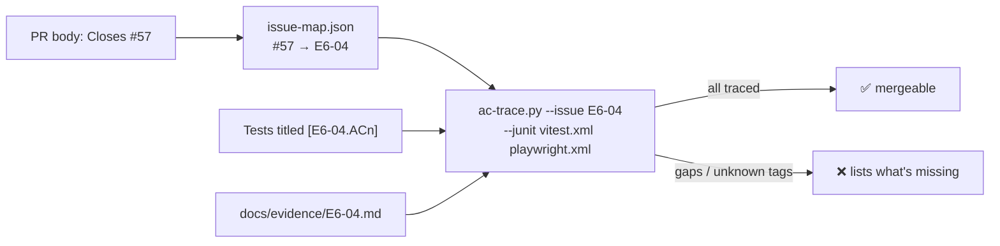

# Verifying acceptance criteria

Every criterion in [`docs/plan/epics/`](../plan/epics/) has a stable tag:

| Kind | Example in the plan | Tag |
|---|---|---|
| Issue acceptance criterion | `- [ ] `AC2` Parser never throws…` under **E6-04** | `E6-04.AC2` |
| Epic success criterion | `- [ ] `SC1` Supported command matrix…` under **E6** | `E6.SC1` |
| Manual criterion | `- [ ] `AC3` `manual` Ben signs off…` | `E1-01.AC3` (evidence, not a test) |

**Never renumber an existing criterion.** If one becomes obsolete, strike it through and mark it `manual` with evidence explaining why. Add new criteria at the end.

## Automated criteria: tag the test title

The tag goes in square brackets at the start of the test title. One test may cover several criteria, and one criterion may have several tests.

```ts
// Vitest (src/sim/commands/parser.test.ts)
it('[E6-04.AC1] never throws on 10,000 random inputs', () => { /* fast-check */ });

// Playwright (e2e/skeleton.spec.ts)
test('[E5-07.AC1] [E3.SC1] landing → quiz → lesson → resume on the deployed site', async ({ page }) => { /* … */ });
```

E0-10 adds `acTest('E6-04.AC1', 'title', fn)` helpers that build this prefix for you.

A criterion counts as traced only when **all** of these are true:
- A test title carries the tag
- The test isn't skipped (`.skip`, `.todo`, `.fixme`, `xit`)
- In CI, the JUnit report from that run shows it **ran and passed** (`--junit`)

## Manual criteria: write evidence

Create or extend `docs/evidence/<ISSUE-ID>.md` (or `<EPIC-ID>.md` for success criteria):

```markdown
## E6-09.AC1
NVDA 2025.3 + Firefox 140, Windows 11: typed `kubectl get pods -n ravenpost`; NVDA announced
"command: kubectl get pods…" then "4 lines of output, press Alt+O to read". VoiceOver + Safari 19: same.
Recording: <link to PR attachment>
```

Evidence must be non-empty. CODEOWNERS requires the SME/lead's approval for anything under `docs/evidence/`.

## Running the tracer

```bash
python3 scripts/ac-trace.py                       # summary
python3 scripts/ac-trace.py --issue E6-04         # what's left for one issue (strict)
python3 scripts/ac-trace.py --report out.md       # full matrix
python3 scripts/ac-trace.py --strict-all          # launch gate: everything traced
python3 -m unittest discover scripts/tests        # the tracer's own tests
```

## In CI
- **`plan`** validates the plan, runs the tracer's unit tests, and publishes the matrix on every change.
- **`ac-trace`** reads `Closes #n` from the PR body, maps `#n` to its plan ID via `docs/plan/issue-map.json`, and fails the PR if any criterion of that issue is untraced.
- Tags that don't match any criterion (typos or stale IDs) always fail.


